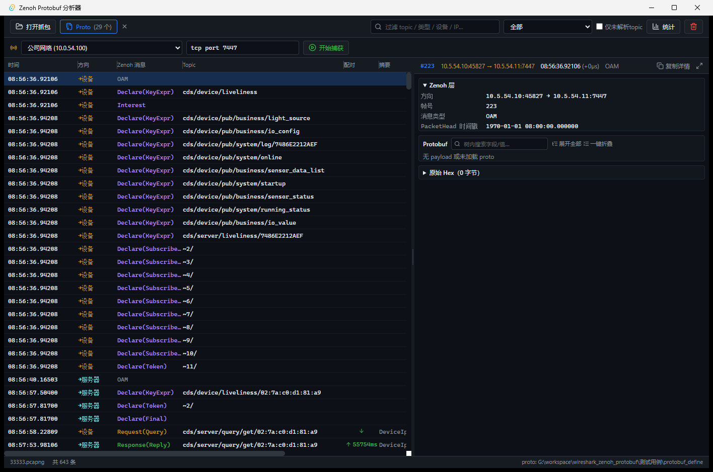

# Zenoh Protobuf 分析器

独立的 **Zenoh + Protobuf** 调试工具：打开 pcapng 抓包文件或实时捕获网卡流量，解析出每条 Zenoh 消息的时间、主题（Topic）、protobuf 内容，支持数组递归展开、请求响应配对、统计面板。

基于 **Tauri 2 + Rust + Vue 3 + TypeScript + Vite + TailwindCSS**。



## 功能

### 离线分析
- 打开 **pcapng / pcap** 文件，解析 TCP 7447 上的 Zenoh 会话
- 消息列表：绝对时间、方向、Zenoh 消息类型（Push/Request/Response/Declare...）、Topic、设备 ID、摘要
- **Request/Response 自动配对**：按 rid 关联，显示往返耗时（RTT），选中高亮同组消息
- 详情面板：Zenoh 层字段 / **Protobuf 树** / 原始 Hex，可拖拽分隔，⤢ 一键最大化
- Protobuf 树：`Any.type_url` 自动解包业务消息、数组递归展开、enum 显示名称、bytes hex 分页、树内搜索、一键展开/折叠
- Protobuf 定义目录（.proto）界面选择，修改后自动重新解析；**proto 缺失时按 wire format 裸解码兜底**
- 统计面板：消息类型分布、Topic 计数、时间范围、设备列表

### 实时捕获
- 选择网卡 + BPF 过滤器（默认 `tcp port 7447`）实时解析显示
- 暂停显示（后台继续缓冲）/ 跟随最新
- 会话中途加入时 topic 显示 `~{id}/…` 标记，不崩溃
- 需要管理员权限

### 解析能力
- Zenoh 1.x 线协议（Zenoh080）：Batch/Frame/Declare/Push/Request/Response/OAM/Interest，keyexpr 映射跨流还原
- TCP 流重组：乱序排序、重传去重、Keep-Alive 探测包过滤
- Protobuf 动态解码：运行时编译 .proto（protox），`common.PubData/ReqData/RespData` 包装 + `Any` 递归解包

## 运行截图

实时解析 `33333.pcapng`：左侧消息列表（643 条，含 Topic/配对 RTT/摘要），右侧详情面板（Zenoh 层 + Protobuf 树 + Hex）：

## 构建与运行

### 前置要求

- [Node.js](https://nodejs.org/) ≥ 18、[Rust](https://rustup.rs/) ≥ 1.77
- Windows：[Npcap](https://npcap.com/#download)（实时捕获必需；离线分析不需要）
- Windows 编译 pcap 绑定需要 [Npcap SDK](https://npcap.com/#download)：解压后通过环境变量指定

```bash
# 环境变量（路径按实际 SDK 位置调整）
set LIBPCAP_LIBDIR=C:\path\to\npcap-sdk\Lib\x64
```

### 开发运行

```bash
npm install
npm run tauri dev
```

### 构建发布版

```bash
npm run tauri build
# 产物：src-tauri/target/release/bundle/{nsis,msi}/
```

## 使用说明

1. **选择 proto 目录**：工具栏「Proto」→ 选择包含 `.proto` 文件的根目录（import 路径相对此目录）
2. **打开抓包文件**：工具栏「打开抓包」→ 选择 pcapng/pcap
3. 或切换到实时捕获栏：选择网卡 →「开始捕获」
4. 点击消息行（或 ↑↓ 键）查看详情；`Ctrl+C` 复制选中行

## 项目结构

```
src/                      # Vue 前端
  components/             # Toolbar/CaptureBar/PacketTable/SplitPane/DetailPanel/ProtoNode/StatsDialog
  stores/analyzer.ts      # Pinia 状态
src-tauri/src/            # Rust 后端
  source.rs               # pcapng/pcap 文件解析
  reassembly.rs           # TCP 流重组
  zenoh.rs                # Zenoh 线协议解析（Zenoh080）
  protobuf.rs             # protox + prost-reflect 动态解码
  pipeline.rs             # 解析管线编排
  commands.rs             # Tauri 命令 + 实时捕获
```

## 许可

本项目代码仅供内部调试使用。第三方组件许可：Zenoh（EPL-2.0/Apache-2.0）、Npcap（免费用于个人用途，商业分发需授权）。
